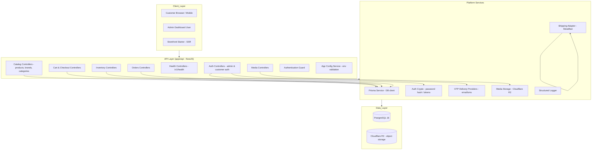

# Use Case, User Flow, and High-Level Architecture

## 1. Overview

The Custom E-commerce Platform is a reusable, multi-tenant e-commerce system. Each client gets their own database and storefront, but all clients run the same NestJS API and shared Prisma schema. The platform is built for the Bangladesh market (BD country code, poisha currency, Steadfast courier, bKash/shurjopay payments, Bengali/English locales) but is designed to be client-configurable.

**Workspace layout:**

| Package/App | Purpose |
|---|---|
| `apps/api` | NestJS REST API, versioned at `/v1` |
| `apps/admin` | Admin dashboard (placeholder) |
| `apps/storefront-starter` | SSR storefront starter (placeholder) |
| `packages/database` | Prisma schema, migrations, generated client, seed scripts |
| `packages/shared-types` | Shared TypeScript contracts |
| `packages/api-sdk` | Typed TypeScript client generated from OpenAPI |
| `docker/` | Local PostgreSQL and CI helpers |

## 2. Use Cases

The platform supports two primary actor groups: **storefront customers** and **store administrators**. Use cases are grouped by domain.

### 2.1 Customer (Storefront)

| ID | Use Case | Description | Status |
|---|---|---|---|
| UC-01 | Browse catalog | View categories, brands, products, and product variants with localized (en/bn) names and slugs | Implemented (read) |
| UC-02 | Register account | Create a customer account with email or phone | Implemented |
| UC-03 | Authenticate (OTP) | Log in via OTP sent to email or phone; verify OTP to establish a session | Implemented |
| UC-04 | Manage cart | Add, update, and remove cart items; view cart totals | Implemented |
| UC-05 | Checkout | Convert a cart into an order with shipping address, zone, and payment method | Implemented |
| UC-06 | View orders | View order history and order status | Planned |
| UC-07 | Request return | Submit a return request for delivered order items | Planned |
| UC-08 | Update profile | Update customer name, addresses, and contact details | Planned |
| UC-09 | Resend OTP / password reset | Request a new OTP or reset password via OTP verification | Planned |

### 2.2 Administrator (Admin Dashboard)

| ID | Use Case | Description | Status |
|---|---|---|---|
| UC-10 | Admin login | Authenticate as an admin user with role-based access | Implemented |
| UC-11 | Manage brands | Create, update, archive brands (with localized names/slugs and images) | Implemented |
| UC-12 | Manage categories | Create a category tree, localize names/slugs, assign category images | Implemented |
| UC-13 | Manage products | Create products with variants, attributes, media, and localized descriptions | Implemented |
| UC-14 | Manage inventory | Adjust stock levels; view stock reservations and movements | Implemented |
| UC-15 | Manage media | Upload media assets to Cloudflare R2; associate with products/categories/banners | Implemented |
| UC-16 | Manage orders | View orders; change order status with audit history | Planned |
| UC-17 | Manage returns | Approve/reject returns; record receipt and refund | Planned |
| UC-18 | Manage coupons | Create discount coupons (percentage/fixed, usage limits, date windows) | Planned |
| UC-19 | Manage CMS | Publish pages and banners with localized content | Planned |
| UC-20 | Manage settings | Configure tax, payment, courier, and notification settings | Planned |
| UC-21 | Manage users/roles | Create admin users; assign roles and permissions | Planned |
| UC-22 | Configure shipping | Define shipping zones, districts, and delivery fees | Planned |
| UC-23 | Run migrations/seeds | Apply schema migrations and seed baseline data per client | Implemented (CLI) |

### 2.3 System (Platform Operator)

| ID | Use Case | Description |
|---|---|---|
| UC-24 | Provision client database | Create a new client database with the two-identity split (`app_runtime` / `app_migrator`) |
| UC-25 | Deploy schema migration | Run `pnpm db:migrate` with checksum validation against committed migration files |
| UC-26 | Seed client data | Run `pnpm db:seed` to install baseline roles, permissions, settings, zones, and optional first admin |
| UC-27 | Health monitoring | Liveness and readiness probes; readiness returns 503 when schema is out of sync |

## 3. User Flows

### 3.1 Customer Registration and Login (OTP)

```
Customer                          API                          Database
  |                                |                             |
  |---- POST /storefront/customers |----------------------->  |
  |  (register email/phone)        |  INSERT customers       |  |
  |                                |<-----------------------   |
  |<---- 201 Created               |                        |
  |                                |                             |
  |---- POST .../auth/otp          |----------------------->  |
  |  (request OTP)                 |  INSERT otp_codes       |  |
  |                                |  (send via email/sms)   |  |
  |                                |<-----------------------   |
  |<---- 200 OK                    |                        |
  |                                |                             |
  |---- POST .../auth/otp/verify   |----------------------->  |
  |  (submit OTP code)             |  verify + UPDATE        |  |
  |                                |  customers.verified_at  |  |
  |                                |<-----------------------   |
  |<---- 200 OK + session          |                        |
```

### 3.2 Browse Catalog and Add to Cart

```
Customer                          API                          Database
  |                                |                             |
  |---- GET /storefront/products   |----------------------->  |
  |                                |  SELECT products,       |  |
  |                                |    variants, media      |  |
  |                                |<-----------------------   |
  |<---- 200 + product list        |                        |
  |                                |                             |
  |---- POST /storefront/carts     |----------------------->  |
  |  /{cartId}/items               |  UPSERT cart_items      |  |
  |  (variantId, quantity)         |  SELECT inventory       |  |
  |                                |<-----------------------   |
  |<---- 200 + cart                |                        |
```

### 3.3 Checkout

```
Customer                          API                          Database
  |                                |                             |
  |---- POST /storefront/carts     |----------------------->  |
  |  /{cartId}/checkout            |  validate stock,        |  |
  |  (shipping, payment method)    |  create Order,          |  |
  |                                |  OrderItems, Payment,   |  |
  |                                |  Shipment, StockReservation  |
  |                                |  UPDATE inventory       |  |
  |                                |<-----------------------   |
  |<---- 201 + order               |                        |
```

### 3.4 Admin Catalog Management (Brands / Categories / Products)

```
Admin                            API                          Database
  |                                |                             |
  |---- POST /admin/products       |----------------------->  |
  |  (product + variants + media)  |  INSERT products,       |  |
  |                                |  variants, media links  |  |
  |                                |<-----------------------   |
  |<---- 201 + product             |                        |
  |                                |                             |
  |---- POST /admin/inventory      |----------------------->  |
  |  /{variantId}/adjustments      |  UPDATE inventory_item  |  |
  |                                |  INSERT stock_movement  |  |
  |                                |<-----------------------   |
  |<---- 200 OK                    |                        |
```

### 3.5 Admin Order Status Change

```
Admin                            API                          Database
  |                                |                             |
  |---- PATCH .../orders/{id}      |----------------------->  |
  |  (status: confirmed -> shipped)|  UPDATE orders          |  |
  |                                |  INSERT order_status_history  |
  |                                |<-----------------------   |
  |<---- 200 OK                    |                        |
```

## 4. High-Level Architecture

### 4.1 Component Diagram (Mermaid)



### 4.2 Layered Architecture

```
┌─────────────────────────────────────────────────────────────┐
│  Presentation Layer                                           │
│  • NestJS controllers (REST, /v1)                            │
│  • OpenAPI 3.1 contract (source of truth)                   │
│  • Problem Details responses (RFC 7807)                      │
│  • Generated TypeScript SDK (packages/api-sdk)               │
└─────────────────────────────────────────────────────────────┘
┌─────────────────────────────────────────────────────────────┐
│  Application Layer                                            │
│  • Feature services: auth, catalog, cart-checkout,           │
│    inventory, media, orders, shipping                        │
│  • Transactional boundaries (Prisma $transaction)            │
│  • Role-based access control (roles/permissions)             │
└─────────────────────────────────────────────────────────────┘
┌─────────────────────────────────────────────────────────────┐
│  Infrastructure Layer                                         │
│  • Prisma ORM + PostgreSQL 16                                │
│  • Cloudflare R2 (media storage)                             │
│  • OTP providers (email/sms)                                 │
│  • Steadfast courier adapter                                 │
│  • Structured logging                                        │
└─────────────────────────────────────────────────────────────┘
┌─────────────────────────────────────────────────────────────┐
│  Data Layer                                                   │
│  • Committed Prisma migrations (checksum-validated)          │
│  • Two database identities: app_runtime / app_migrator       │
│  • schema_version view over Prisma ledger                    │
└─────────────────────────────────────────────────────────────┘
```

### 4.3 Key Architectural Decisions

**Two database identities:** The runtime API connects as `app_runtime` (DML only: SELECT/INSERT/UPDATE/DELETE, no DDL). Migrations run as `app_migrator` (owns schema, may run DDL). The API never receives the migrator URL.

**Schema-version gating:** The API checks the database schema version before binding a listener and on every readiness request. A database that is behind, ahead, or uninitialized causes startup failure or 503.

**Immutable migrations:** Applied migrations are immutable. `pnpm db:migrate` verifies SHA-256 checksums of all applied migrations before applying anything and fails on drift.

**Per-client tenancy:** Each client provisions their own database and storefront but shares the same API binary and schema. Client-specific credentials (R2, courier, OTP) come from a secret manager and are never committed.

**Contract-first:** The OpenAPI document in `apps/api/openapi/openapi.yaml` is the canonical contract. Only operations in `x-implemented-operations` are runtime routes; others are planned integration boundaries.

**Localization:** Catalog content (categories, brands, products) supports `en` and `bn` locales with per-locale slugs and translations.

**Currency:** All monetary amounts are stored as integers in poisha (1/100 of a Bangladeshi taka).

## 5. Domain Model Summary

Core entities and their relationships:

- **Customer** → addresses, carts, orders, coupon redemptions
- **Product** → category, brand, translations, variants, media
- **ProductVariant** → SKU, price, attributes, inventory item, cart/order items
- **InventoryItem** → stock reservations, stock movements
- **Cart** → customer, items → order
- **Order** → customer, cart, shipping zone, coupon, items, status history, returns, payments, shipments
- **Payment** → order, method (cod/bkash/shurjopay), status
- **Shipment** → order, courier (steadfast), tracking, status
- **AdminUser** → role, status changes
- **AdminRole** → permissions, scope (store/platform)
- **MediaAsset** → provider (R2), linked to products, categories, brands, CMS banners
- **ShippingZone** → districts, delivery fee
- **Coupon** → discount rules, redemptions
- **CmsPage / CmsBanner** → localized content, publication status
- **StoreSetting** → JSON key/value configuration
- **AuthSession / AuthRefreshToken** → customer/admin identity sessions

## 6. Deployment Sequence

For a new client database:

1. Create the database with `app_migrator` and `app_runtime` roles (see `docker/initdb/01-roles.sql`)
2. Run `pnpm db:migrate` with `MIGRATION_DATABASE_URL` to apply schema
3. Run `pnpm db:seed` with `DATABASE_URL` to install baseline data (roles, permissions, settings, zones)
4. Optionally set `SEED_ADMIN_EMAIL` / `SEED_ADMIN_PASSWORD` to bootstrap the first admin user
5. Start the API with `DATABASE_URL`; health/ready endpoints confirm schema sync

For each deployment:

1. Snapshot the database
2. Migrate with `MIGRATION_DATABASE_URL`
3. Start the API with `DATABASE_URL`