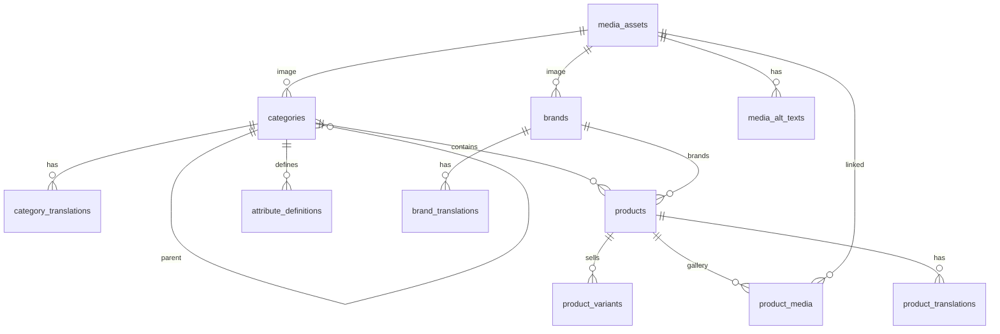

## Context

See `proposal.md` for motivation and `specs/catalog/spec.md` and `specs/media/spec.md` for the
behavior this design must deliver. Scope follows `docs/plan.md` items 4 and 6.

The foundation change left `packages/database/prisma/schema.prisma` with only a datasource and
generator. The migration stream contains `20260101000000_init`, which creates the `schema_version`
view over `_prisma_migrations`. `src/expected-version.ts` currently points at that migration, and the
migration script refuses to run if an applied migration's checksum changed. This change adds the
first domain tables through exactly that stream.

Constraints that shape the design:

- One PostgreSQL database per client, one shared schema, no `client_id` columns.
- PostgreSQL 16; Prisma 6.19.3; migrations are committed SQL and forward-only.
- All money is BDT and stored as integer poisha (user decision).
- A product has one primary category (user decision); multi-category is deferred.
- No API, admin, search, seed, inventory, or order code in this change.

## Goals / Non-Goals

**Goals:**

- A normalized catalog schema that later API changes can query without renaming or restructuring.
- Database-enforced integrity for the relationships that are cheap to enforce now.
- Bangla and English content with locale-unique slugs and SEO fields.
- Media metadata that the future R2 upload flow can populate without storing binaries in PostgreSQL.
- Integration tests that prove the constraints against real PostgreSQL, not just generated types.

**Non-Goals:**

- Validating variant attributes against their definitions in the database. JSONB stores the shape;
  the catalog API will validate values against `attribute_definitions`.
- Preventing every possible category cycle in SQL. Self-parenting is blocked; deep cycles are an
  API concern.
- GIN indexes for attribute search, full-text search, or storefront query tuning.
- A seed catalog or default categories.
- Splitting the Prisma schema into multiple files. The catalog is manageable in one file; revisit
  when order tables arrive.

## Decisions

### 1. UUID primary keys generated by PostgreSQL

Every catalog entity uses `uuid` with `DEFAULT gen_random_uuid()`. Foreign keys use the same type.

- **Why:** IDs are generated without a round trip and remain unique across imports, seeds, and
  future client merges. PostgreSQL 16 provides `gen_random_uuid()` without an extension.
- **Alternatives:** auto-increment integers (leak volume and complicate imports), ULIDs generated in
  the app (useful later for sortable IDs, but adds a dependency now).

### 2. Money is integer poisha

`price_poisha` and `compare_at_price_poisha` are `INTEGER NOT NULL`/`INTEGER NULL` with
`CHECK (value >= 0)`. The column names carry the unit so no caller can mistake the value for taka.

- **Why:** exact arithmetic, no floating-point drift, no locale-dependent rounding. 125000 is
  unambiguous as ৳1,250.00.
- **Alternatives:** `NUMERIC(12,2)` (workable, but invites decimal handling in every service),
  floating point (rejected).
- The API layer owns formatting and any future currency display; the database never stores taka.

### 3. One primary category per product

`products.category_id` is `uuid NOT NULL` with `ON DELETE RESTRICT`. Multi-category would require a
join table and changes to every catalog query, so it waits for a real requirement.

- **Why:** the storefront URL, breadcrumb, and attribute definitions all key off the category.
- **Alternative:** `product_categories` join table with an `is_primary` flag (more flexible, but the
  ordering and invariants would be invented before the API needs them).
- If multi-category arrives, add the join table and backfill from `category_id`, then deprecate the
  column in a later contract migration.

### 4. Translation tables per entity, not JSONB columns

`category_translations`, `brand_translations`, and `product_translations` each use
`PRIMARY KEY (entity_id, locale)` with a `content_locale` enum (`bn`, `en`). Each has `name`, `slug`,
optional `meta_title` and `meta_description`, and product adds `description` and
`short_description`. Slugs are unique per entity type and locale:

```sql
UNIQUE (locale, slug)
```

- **Why:** rows are easy to add, validate, and query; one locale cannot overwrite another; the unique
  index makes storefront URLs collision-free without application locking.
- **Alternatives:** `name_bn`/`name_en` columns (harder to extend to another locale and clutters
  every table), a single JSONB `translations` column (weaker constraints, harder to index slugs).
- Locale is an enum now because the product is explicitly bn/en. Adding a locale later is a forward
  enum migration, not a schema redesign.
- Slugs are globally unique within a locale per entity type, not scoped by category. This keeps
  `/products/:slug` simple; prefixes can be applied by the storefront later.

### 5. Lifecycle status enums instead of hard deletes

`categories` and `brands` use `active`/`archived`; `products` use `draft`/`active`/`archived`;
variants use `active`/`archived`. Admin flows archive by default.

Hard deletes remain possible for cleanup but are constrained: a category with products or children
cannot be deleted, while deleting a product cascades its variants, translations, and media links.
Future order tables will reference variants with `ON DELETE RESTRICT`, which will make deletion of
ordered products fail naturally.

- **Why:** catalog history matters for orders and links; archiving keeps IDs stable.
- **Alternative:** soft-delete timestamps on every table (more filtering rules in every query, and
  unique slugs/SKUs become harder to reuse).

### 6. Category-scoped attribute definitions plus JSONB variant values

`attribute_definitions` belongs to a category and stores `attribute_key`, `value_type`
(`text`, `number`, `boolean`, `select`), `is_required`, `is_filterable`, `options TEXT[]`, and
`sort_order`, with `UNIQUE (category_id, attribute_key)`.

`product_variants.attributes` is `JSONB NOT NULL DEFAULT '{}'`. The API will validate keys and values
against the definitions for the product's category before writing.

- **Why:** different categories need different attributes (size/color versus weight/pack size)
  without a migration per attribute. Definitions still give the admin form a stable shape.
- **Alternatives:** EAV tables (many joins and weak typing), a column per attribute (migration per
  category change), a schemaless JSONB-only approach (no form metadata or filter hints).
- A `CHECK (value_type <> 'select' OR cardinality(options) > 0)` protects select definitions.
- Add a GIN index on `attributes` only when search needs it; premature indexes cost write throughput.

### 7. Media is metadata; binaries live in R2

`media_assets` stores `provider` (`media_provider` enum, currently `r2`), `storage_key`, `mime_type`,
`size_bytes BIGINT`, nullable `width`/`height`, and timestamps, with
`UNIQUE (provider, storage_key)`. `media_alt_texts` stores per-locale alt text.

`product_media` links products to assets with `sort_order` and `is_primary`. A partial unique index
enforces one primary per product:

```sql
CREATE UNIQUE INDEX product_media_one_primary
  ON product_media (product_id) WHERE is_primary;
```

`categories.image_media_id` and `brands.image_media_id` are nullable FKs with `ON DELETE SET NULL`.

- **Why:** binaries do not belong in PostgreSQL; keys are stable and portable; the unique provider/key
  pair prevents duplicate records after retries.
- **Alternatives:** storing URLs (bakes the CDN host into data), storing binaries in `BYTEA` (backup
  and memory cost), one polymorphic `media_links` table (loses typed foreign keys).
- Prisma cannot express partial unique indexes or CHECK constraints in `schema.prisma`. They live in
  the SQL migration and are covered by integration tests. The migration stream remains the source of
  truth for the physical schema.

### 8. Constraint and index choices

Beyond the unique indexes above:

- `CHECK (parent_id IS NULL OR parent_id <> id)` on `categories`.
- `CHECK (value >= 0)` on variant prices and media size; width and height are either both null or
  both positive.
- `ON DELETE RESTRICT` for `products.category_id`, `products.brand_id`, and `categories.parent_id`.
- `ON DELETE CASCADE` for translations, variant rows, attribute definitions, media alt text, and
  product/media links.
- Index foreign keys used by listings: `products(category_id)`, `products(brand_id)`,
  `products(status)`, `product_variants(product_id)`, `categories(parent_id)`,
  `attribute_definitions(category_id)`, `product_media(product_id)`, `product_media(media_id)`.
- `updated_at` is set by Prisma writes (`@updatedAt`) with a database default of `now()`. Raw SQL
  writes must set it explicitly; no trigger is added in this change.

### 9. One forward migration, no data backfill

Add `prisma/migrations/<timestamp>_catalog/migration.sql` after `20260101000000_init`, containing
enums, tables, checks, and indexes in dependency order. Models are added to
`prisma/schema.prisma` with `@@map`/`@map` snake_case names.

- **Why one migration:** the tables are new and always applied together; splitting would add no
  recovery value.
- **Why no backfill:** there is no production catalog yet.
- Regenerate `src/expected-version.ts` through `db:generate`; CI already fails when it is stale.
- Migration filename uses the next stream timestamp, not the current date, so ordering stays obvious.

### 10. Relationship overview



## Risks / Trade-offs

- **Deep category cycles are not blocked in SQL** → the category API must walk ancestors before
  changing `parent_id`, and an integration test should cover it once that API exists. Until then,
  admin writes are the only source of category changes.
- **JSONB attributes are not validated by the database** → the catalog API validates keys and values
  against `attribute_definitions`; invalid legacy rows can only come from direct SQL.
- **Partial unique index and CHECK constraints are invisible to Prisma** → they are maintained in
  committed SQL and tested against PostgreSQL; never rely on `prisma db push` for this schema.
- **Deleting a product cascades variants** → normal flows archive products. When order tables arrive,
  their `RESTRICT` foreign keys will prevent deleting ordered variants; document that migration.
- **Enum changes require migrations** → add values with a forward migration; never rename an enum
  value in place while old API versions may still send it.
- **Global slug uniqueness may be too rigid** for future category-scoped URLs → moving to
  `(category_id, locale, slug)` later is a forward migration and a storefront routing change; global
  slugs are simpler for now.
- **`BIGINT` media size needs serialization care** → the media API will expose byte size as a string
  (or a safe integer after validation) rather than leaking a Prisma `BigInt` into JSON.
- **One large schema file grows further with orders** → split into a Prisma schema folder in the
  order-schema change, not here.

## Migration Plan

1. Add the catalog models to `schema.prisma` and write the forward SQL migration. Apply locally to a
   fresh database with `pnpm --filter database db:migrate`.
2. Run `db:migrate` a second time and confirm it is a no-op; run `db:status` and assert
   `schema_version` reports the catalog migration.
3. Run integration tests for locale uniqueness, SKU uniqueness, integer money, category restrictions,
   primary-media uniqueness, and media cascade behavior.
4. Regenerate the Prisma client and `expected-version.ts`; commit both with the migration.
5. Deploy order for clients with an existing database: snapshot → `db:migrate` with the migration
   identity → start the API. There is no backfill and no API change in this release.
6. Rollback is snapshot restore. If a mistake ships, add a forward migration; do not edit the
   catalog migration after it has been applied.
