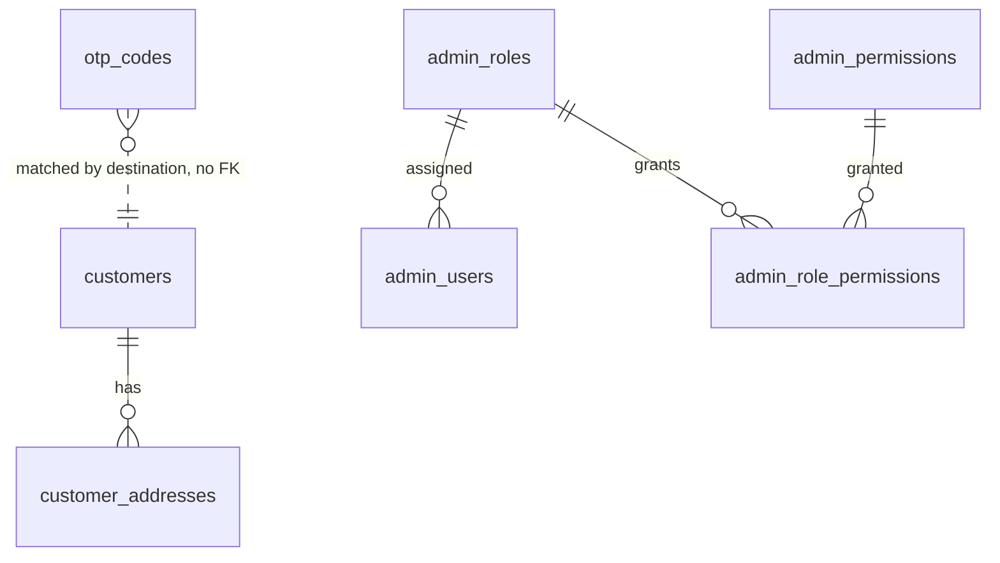

## Context

See `proposal.md` for motivation and `specs/auth-customers/spec.md` and `specs/auth-admin/spec.md`
for the behavior this design must deliver. Scope follows `docs/plan.md` items 4, 8, 12, and 26.

The catalog and inventory changes added the first domain tables. The migration stream now contains
`20260101000000_init`, `20260102000000_catalog`, and `20260103000000_inventory`;
`src/expected-version.ts` points at the inventory migration, and `db:migrate` refuses to apply
anything if an applied migration's checksum changed. This change adds the identity tables through that
same stream.

Constraints that shape the design:

- One PostgreSQL database per client, one shared schema, no `client_id` columns.
- PostgreSQL 16; Prisma 6.19.3; migrations are committed SQL and forward-only.
- Customer email login uses email plus password (user decision); phone login stays OTP-based.
- Admin authorization uses editable roles and permissions tables (user decision), seeded with the
  store roles owner, manager, staff, and support by the seed change. Platform super-admin seeding
  is deferred to a separate future change.
- The platform super-admin role is separate from store roles (project decision).
- Carts, orders, notifications, and audit logging do not exist yet.
- No API, admin UI, seed, provider, or background-worker code in this change.

## Goals / Non-Goals

**Goals:**

- A normalized identity schema the future customer-auth and admin-auth APIs can use without
  restructuring.
- Database-enforced integrity for unique identities, default addresses, OTP state, role assignment,
  and authorization data.
- Hashed credentials and OTP codes with no plaintext storage path in the schema.
- A role/permission model that supports the later admin roles screen and keeps platform
  administration separate.
- Integration tests that prove the constraints against real PostgreSQL.

**Non-Goals:**

- Session, refresh-token, or JWT storage; those arrive with the auth API changes.
- Password hashing algorithms, OTP generation, provider delivery, or rate-limit middleware. The
  database stores opaque hashes and timestamps; the API owns the algorithms and windows.
- Seeding the default roles, permissions, or first admin user.
- Audit logging or immutable authorization history; change #6 owns the audit log.
- Guest-order contact snapshots, customer segmentation, loyalty, or marketing attributes.
- Multi-role admins and per-user permission overrides.
- Splitting the Prisma schema into multiple files; the order schema change will trigger that.

## Decisions

### 1. UUID primary keys and normalized identifiers

Every identity entity uses `uuid` with `DEFAULT gen_random_uuid()`. Phone numbers are stored in E.164
format and emails are stored lowercase.

- **Why:** UUIDs match the catalog and inventory convention, are generated without a round trip, and
  do not leak customer or staff volume. Normalizing identifiers at the write boundary makes unique
  indexes and lookups predictable.
- **Alternatives:** auto-increment integers (leak volume and complicate imports), `citext` for email
  (adds an extension and a type that the rest of the schema does not use), or case-insensitive unique
  expression indexes (workable, but every query would still need to normalize).
- Emails are normalized in the API and a `CHECK (email = lower(email))` rejects mixed-case rows if a
  writer bypasses that step. Phone numbers use a `CHECK` against
  `^\+[1-9][0-9]{7,14}$`; the API converts local Bangladeshi numbers before writing.

### 2. Customers have optional phone and email, but at least one identity

`customers` stores nullable `phone` and `email`, each with a unique constraint, plus a
`CHECK (phone IS NOT NULL OR email IS NOT NULL)`. PostgreSQL unique constraints allow multiple NULLs,
so many phone-only or email-only accounts coexist.

- **Why:** a customer may start with phone OTP and add email later, and another may register with
  email only. Making either column mandatory would force fake values or duplicate account types.
- **Alternatives:** separate phone and email identity tables (more joins and more places to enforce
  "at least one"), or a single `login` column with a type flag (loses typed uniqueness).
- A customer may carry both identities. The API owns merging an OTP signup with an existing email
  account; the schema only prevents duplicate values.

### 3. Customer email credentials use a password hash; phone-only accounts have none

`customers.password_hash` is nullable. A check requires that a hash is present only when an email is
present, and another check rejects an empty or very short value. The API hashes passwords with
Argon2id; the database stores the encoded hash and never interprets it.

- **Why:** the user chose email plus password, while phone-only customers must remain valid. Keeping
  the hash nullable models both account types without inventing a second table. The length floor
  catches accidental plaintext writes; it is not a proof that the value is hashed.
- **Alternatives:** a separate `customer_credentials` table (useful if multiple credential types
  arrive, but premature for one password), storing a plaintext password (rejected), or making the
  email mandatory for every customer (breaks phone OTP signup).
- `email_verified_at`, `phone_verified_at`, and `last_login_at` are nullable so the auth API can
  record verification and login state without another migration.

### 4. Addresses are structured rows owned by a customer

`customer_addresses` stores `customer_id` (required, `ON DELETE CASCADE`), `label`, `recipient_name`,
`recipient_phone`, `address_line1`, nullable `address_line2`, nullable `area`, `district`, `division`,
nullable `postal_code`, `country_code CHAR(2) DEFAULT 'BD'`, and the two default flags.

- **Why:** the later delivery-charge rule is by zone (inside or outside Dhaka), so district and
  division must be queryable rather than buried in a free-text blob. Recipient name and phone are
  required because they are printed on the parcel and may differ from the account holder.
- **Alternatives:** one free-text address column (cannot compute zones), a JSONB address (no shape
  guarantees), or storing addresses only on orders (the account address book would be impossible).
- Partial unique indexes enforce one default shipping and one default billing address per customer:
  ```sql
  CREATE UNIQUE INDEX customer_addresses_one_default_shipping
    ON customer_addresses (customer_id) WHERE is_default_shipping;
  CREATE UNIQUE INDEX customer_addresses_one_default_billing
    ON customer_addresses (customer_id) WHERE is_default_billing;
  ```
  A single address may satisfy both indexes. Changing a default requires clearing the old default and
  setting the new one in one transaction; the API owns that flow.
- Deleting a customer cascades addresses because they are account data. Orders will snapshot the
  delivery address when the order schema arrives, so order history will not depend on these rows.

### 5. OTP records are hashed, historical, and not linked to a customer

`otp_codes` stores `id`, `channel` (`sms`, `email`), `purpose` (`customer_login`,
`phone_verification`, `email_verification`, `password_reset`), `destination`, `code_hash`,
`expires_at`, nullable `consumed_at`, nullable `invalidated_at`, `attempts`, `max_attempts`, and
`created_at`. There is no customer foreign key.

- **Why:** a login OTP can be requested before a customer row exists, and the destination (not the
  account) is the natural lookup key. Keeping history supports issuance-rate counting and later
  forensics. A new code invalidates the previous active code rather than deleting it.
- **Alternatives:** a foreign key to `customers` (breaks first-time phone signup and complicates guest
  checkout), storing only the newest code per destination (loses rate-limit history), or storing raw
  codes (rejected).
- `CHECK (expires_at > created_at)`, `CHECK (attempts >= 0)`, `CHECK (max_attempts > 0)`,
  `CHECK (attempts <= max_attempts)`, and a check that at most one of `consumed_at` and
  `invalidated_at` is set.
- Channel and destination must agree: SMS destinations follow the E.164 pattern, and email
  destinations are lowercase and contain `@`. Purpose and channel must also agree:
  `phone_verification` is SMS; `email_verification` and `password_reset` are email; `customer_login`
  may use either.
- Indexes support `(destination, purpose, created_at)` lookups for the newest code and rate counting,
  and `(expires_at)` for a later cleanup job. No unique index limits active codes, because the history
  itself is required.

### 6. Admins have one role and no session table

`admin_users` stores `id`, `role_id` (required), lowercase unique `email`, `password_hash`,
`display_name`, `status` (`active`, `disabled`), nullable `last_login_at`, and timestamps.

- **Why:** the plan describes each staff member with a role, and one role keeps permission resolution a
  single join. Sessions and refresh tokens belong to the auth API; adding them now would invent
  expiry and revocation rules before the API exists.
- **Alternatives:** an `admin_user_roles` join table (supports multi-role, but the plan does not ask
  for it and every authorization query would need aggregation), or an `is_platform_admin` boolean
  (duplicates the role scope and invites contradictory state).
- `role_id` uses `ON DELETE RESTRICT`, so a role cannot be removed while staff still use it.
- The email and password checks mirror the customer rules: lowercase email, unique, non-empty hash
  with a length floor, and a status enum.

### 7. Roles and permissions are tables; system roles are protected

`admin_roles` stores `key` (unique), `name`, `description`, `scope`, `is_system`, and `sort_order`.
`admin_permissions` stores `key` (unique), `description`, `group_key`, and `sort_order`.
`admin_role_permissions` is a join table with `PRIMARY KEY (role_id, permission_id)`.

- **Why:** the admin dashboard phase includes a roles screen, and the user chose editable roles plus a
  permission catalog. Rows let the screen list, group, and grant permissions without a code change;
  the seed change supplies the default owner, manager, staff, and support roles. Platform
  super-admin seeding is deferred to a separate future change.
- **Alternatives:** a fixed role enum with a permission matrix in code (simpler, but the roles screen
  and client-specific permissions become code changes), or per-user permissions without roles
  (harder to reason about and audit).
- Role and permission keys are stable lowercase identifiers enforced by a `CHECK` regex.
  `admin_role_permissions.role_id` cascades when a custom role is deleted;
  `admin_role_permissions.permission_id` restricts deletion while a grant exists, so a permission
  cannot silently disappear from roles.
- A `BEFORE DELETE` trigger rejects deleting any role with `is_system = true`. Permissions and grants
  on a system role remain editable, because the seed change may adjust defaults and clients may add
  permissions to their owner role.
- Effective permissions are the join of `admin_users.role_id` through `admin_role_permissions`. The
  schema has no per-user grant table.

### 8. Platform administration is a role scope, not a separate table

`admin_roles.scope` is an enum of `store` and `platform`. The seed change creates the four store
roles with store scope; a separate future platform-administration change is responsible for
creating `super_admin` with platform scope. An admin is a platform administrator when the assigned
role has platform scope.

- **Why:** the project requires a separate tech-admin/super-admin role that runs migrations and
  rollbacks, while store roles run the business. A scope column keeps one role table, one assignment
  path, and one source of truth.
- **Alternatives:** a boolean on `admin_users` (can disagree with the role), a separate
  `platform_admins` table (duplicates email and password handling), or an extra role per platform
  action (does not express the separation).
- Reliance on seeded store keys (`owner`, `manager`, `staff`, `support`) is a seed concern, not a
  database enum, so clients can rename display names without a migration. The platform role key is
  deferred to the future platform-administration seed change.

### 9. Constraint and index choices

Beyond the checks above:

- `UNIQUE (phone)` and `UNIQUE (email)` on `customers`; `UNIQUE (email)` on `admin_users`.
- `UNIQUE (key)` on `admin_roles` and `admin_permissions`.
- Foreign keys: addresses cascade with the customer; `admin_users.role_id` restricts;
  `admin_role_permissions` cascades from roles and restricts from permissions.
- Indexes: `customers(status)`, `customer_addresses(customer_id)`, `otp_codes(destination, purpose,
  created_at)`, `otp_codes(expires_at)`, `admin_users(role_id)`, `admin_users(status)`,
  `admin_roles(scope)`, `admin_role_permissions(permission_id)`.
- `created_at` and `updated_at` use `TIMESTAMPTZ(6)`. Prisma writes `updated_at` through `@updatedAt`
  with a `now()` database default; raw SQL writers must set it explicitly. No update triggers are
  added.
- Column and table names use snake_case via `@@map`/`@map`, matching catalog and inventory.

### 10. One forward migration, no backfill

Add `prisma/migrations/20260104000000_customers_auth/migration.sql` after the inventory migration,
containing enums, tables, checks, indexes, foreign keys, and the system-role trigger in dependency
order. Add the models to `prisma/schema.prisma`.

- **Why one migration:** the tables are always applied together and there is no production data to
  backfill.
- Regenerate `src/expected-version.ts` through `db:generate`; CI already fails when it is stale.
- The migration timestamp follows the stream (`20260104...`), not the wall clock, so ordering stays
  obvious.

### 11. Relationship overview



## Risks / Trade-offs

- **Hash enforcement stops at length and non-emptiness** -> the API must use Argon2id for passwords
  and an HMAC or similar for OTP codes. The schema cannot prove a value is hashed; the length floors
  only catch obvious mistakes.
- **E.164 is strict for local input** -> the auth API must normalize local Bangladeshi numbers before
  writing; otherwise valid local input is rejected. That normalization belongs to the auth change.
- **OTP history grows without a retention job** -> the `expires_at` index supports a later cleanup or
  archival job; this change does not delete history.
- **Deleting a customer deletes their address book** -> order history must snapshot delivery data in
  the order schema; it must not rely on live address rows.
- **One role per admin is a simplification** -> multi-role support would need a join table and
  aggregated permission queries; it can be added forward if a client requires it.
- **Seed keys are not enforced as a fixed set** -> the database allows any lowercase role key; the seed
  change and admin roles screen must treat `owner`, `manager`, `staff`, and `support` as store
  system defaults. The platform role is deferred to a future platform-administration seed change.
- **System roles can still be renamed or re-scoped** -> only deletion is blocked. If seed changes must
  be immutable, tighten the trigger in a later migration; renaming a display name is intentionally
  allowed.
- **Authorization changes are not audited in this change** -> change #6 adds the audit log. Until then,
  role/permission edits have no immutable history.
- **No admin password-reset mechanism is modeled** -> the auth API change will decide between OTP and
  reset tokens; the current schema supports customer password reset through the OTP purpose enum only.

## Migration Plan

1. Add the models and enums to `schema.prisma`, write the forward SQL migration, and apply it locally
   to a fresh database with `pnpm --filter database db:migrate`.
2. Run `db:migrate` a second time and confirm it is a no-op; run `db:status` and assert
   `schema_version` reports the customers/auth migration.
3. Run integration tests for customer identities, password rules, address defaults, OTP constraints,
   admin users, roles, permissions, grants, and the system-role trigger.
4. Regenerate the Prisma client and `expected-version.ts`; commit both with the migration.
5. Deploy order for clients with an existing database: snapshot, `db:migrate` with the migration
   identity, then start the API. There is no backfill and no API change in this release.
6. Rollback is snapshot restore. If a mistake ships, add a forward migration; do not edit this
   migration after it has been applied.
