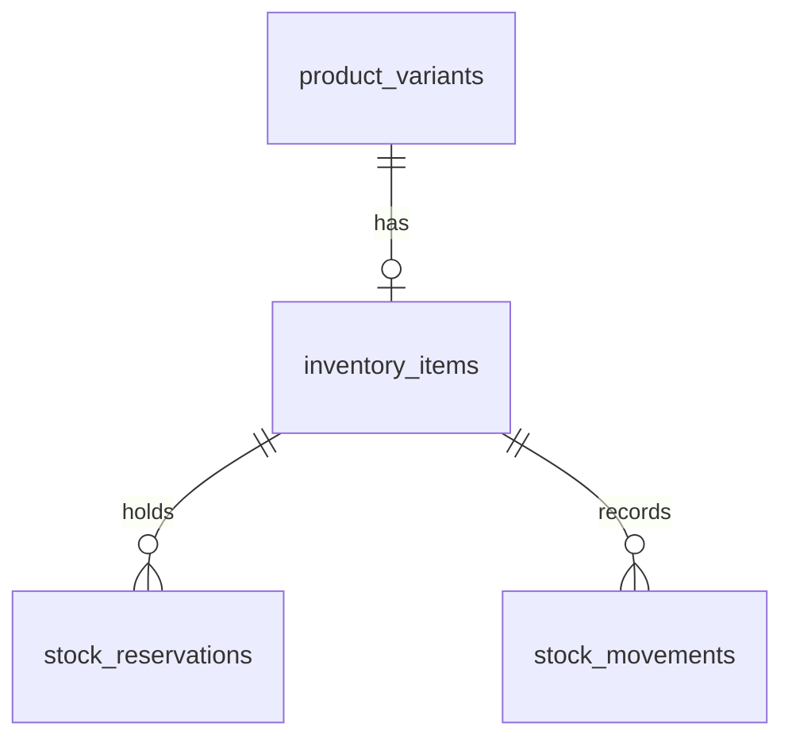

## Context

See `proposal.md` for motivation and `specs/inventory/spec.md` for the behavior this design must
deliver. Scope follows `docs/plan.md` items 4 and 11.

The catalog change added `product_variants` and the media/catalog tables. The migration stream now
contains `20260101000000_init` and `20260102000000_catalog`; `src/expected-version.ts` points at the
catalog migration, and `db:migrate` refuses to apply anything if an applied migration's checksum
changed. Inventory is added through that same stream.

Constraints that shape the design:

- One PostgreSQL database per client, one shared schema, no `client_id` columns.
- PostgreSQL 16; Prisma 6.19.3; migrations are committed SQL and forward-only.
- Single location (user decision), so no location dimension in the schema.
- Carts, orders, and checkout do not exist yet; they arrive in a later change.
- A variant is the sellable unit, and inventory is held per variant.
- No API, admin, notification, or background-worker code in this change.

## Goals / Non-Goals

**Goals:**

- A normalized inventory schema the future inventory API can use without restructuring.
- Database-enforced integrity for one item per variant, non-negative balances, reserved-not-greater-
  than-on-hand, and valid reservation/movement states.
- A durable, append-only ledger that explains every balance change.
- Reservation rows that can later become the checkout hold, without coupling this migration to
  order tables that do not exist yet.
- Integration tests that prove the constraints against real PostgreSQL, not just generated types.

**Non-Goals:**

- Reservation transactions, row locking, or concurrency control. The inventory API owns
  `SELECT ... FOR UPDATE` and writes balances and movements in one transaction.
- Automatically deriving `quantity_reserved` from active reservations with a trigger. The API keeps
  the counter and the reservation rows consistent in the same transaction.
- Automatic reservation expiry, low-stock notifications, scheduled jobs, or event emission.
- Backorders, multi-location stock, transfers, lot tracking, serial numbers, or valuation.
- Splitting the Prisma schema into multiple files; orders will trigger that later.
- Seed inventory or inventory backfill for existing variants.

## Decisions

### 1. Three tables: current balance, reservations, and movements

`inventory_items` holds the current balance per variant; `stock_reservations` holds individual
holds; `stock_movements` is the append-only ledger.

- **Why:** the current balance is read on every product page and checkout, reservations need
  individual status transitions, and the ledger needs a permanent record with different write and
  retention rules. One table cannot serve all three well.
- **Alternatives:** derive available quantity from the movement ledger on every read (correct but
  expensive and race-prone), or keep only a counter (fast but no audit trail and no per-hold release).
- The counter and ledger are intentionally redundant. The API updates both in one transaction; the
  ledger is the audit source, the counter is the fast read model.

### 2. `inventory_items` shares its primary key with the variant

`inventory_items.variant_id` is both the primary key and a foreign key to `product_variants.id` with
`ON DELETE RESTRICT`. There is no separate inventory item id. Reservations and movements reference
`inventory_items.variant_id` with `ON DELETE RESTRICT`.

- **Why:** inventory is a one-to-one extension of a variant. A shared key makes "one item per
  variant" structural rather than a unique-index convention, and it makes reservations/movements
  impossible for a variant that has no inventory item.
- **Alternatives:** a surrogate `id` plus `UNIQUE (variant_id)` (workable, but adds a column and a
  join key that no caller needs); referencing `product_variants` directly from reservations and
  movements (would allow history for variants without a balance row and would not protect item
  deletion).
- A variant cannot be deleted while an inventory item, reservation, or movement exists. This
  preserves history; catalog flows archive variants instead.

### 3. Current balance is three counters, not a stored availability or low-stock flag

`inventory_items` stores `quantity_on_hand`, `quantity_reserved`, and `low_stock_threshold`, all
`INTEGER NOT NULL DEFAULT 0`. Available quantity and low-stock state are derived:

```sql
available = quantity_on_hand - quantity_reserved
is_low_stock = available <= low_stock_threshold
```

- **Why:** derived values cannot drift from their inputs. Storing `is_low_stock` would require every
  quantity update to recompute it, and it would be wrong the moment a threshold changes.
- **Alternatives:** a generated column (Prisma support is awkward and the value still needs an
  index decision), a materialized low-stock table (premature), or a stored boolean (rejected).
- Checks enforce `quantity_on_hand >= 0`, `quantity_reserved >= 0`,
  `quantity_reserved <= quantity_on_hand`, and `low_stock_threshold >= 0`.
- The admin listing can index on the derived expression later if it becomes hot; no expression index
  is added now.

### 4. Reservations are rows with a lifecycle, not ledger entries alone

`stock_reservations` stores `id`, `variant_id`, `quantity`, `status`, optional
`reference_type`/`reference_id`, optional `expires_at`, and timestamps. `status` is an enum of
`active`, `released`, `committed`, and `expired`; the default is `active`.

- **Why:** checkout needs to create a hold, later release or commit it, and possibly let it expire.
  A row with a status makes those transitions explicit and keeps each hold identifiable.
- **Alternatives:** represent a hold only as two movement rows (no place to store status, expiry, or
  a stable hold id); a `reservations` table keyed by order id (orders do not exist yet).
- Only `active` reservations count towards `quantity_reserved`. `released`, `committed`, and
  `expired` rows remain as history.
- A reservation quantity must be positive and must not exceed availability. Availability is checked
  by the API inside the same transaction that increments the counter; the DB check
  `quantity_reserved <= quantity_on_hand` is the backstop.
- `reference_type` is an enum (`cart`, `order`, `manual`) and `reference_id` is a nullable UUID. A
  check requires both to be null or both to be set. This lets a reservation trace back to a cart or
  order without a foreign key to tables introduced later.
- Indexes: `(variant_id)`, `(status, expires_at)` for expiry sweeps, and
  `(reference_type, reference_id)` for lookups by cart/order.

### 5. The ledger stores deltas and resulting balances

`stock_movements` stores `id`, `variant_id`, `type`, `on_hand_delta`, `reserved_delta`,
`resulting_on_hand`, `resulting_reserved`, optional `reference_type`/`reference_id`, optional
`note`, and `created_at`. It has no `updated_at`.

Movement semantics:

| Type          | `on_hand_delta` | `reserved_delta` | Meaning                          |
| ------------- | --------------- | ---------------- | -------------------------------- |
| `initial`     | positive        | 0                | Opening stock for a variant      |
| `adjustment`  | non-zero        | 0                | Manual correction                |
| `reservation` | 0               | positive         | New hold placed                  |
| `release`     | 0               | negative         | Hold released or expired         |
| `deduction`   | negative        | negative         | Hold committed and stock shipped |
| `return`      | positive        | 0                | Units returned to stock          |

- **Why deltas plus balances:** deltas explain what changed; the resulting balances make the ledger
  readable without replaying every earlier row and make reconciliation tests straightforward.
- **Alternatives:** a single signed `quantity_delta` (cannot express a reservation that changes
  reserved but not on-hand), a full before/after row (redundant and wider), or an event-sourced
  design with no counter (too large a change for v1).
- A check enforces the sign rules in the table above and requires at least one non-zero delta.
  Additional checks enforce `resulting_on_hand >= 0`,
  `resulting_reserved >= 0`, and `resulting_reserved <= resulting_on_hand`.
- `reference_type`/`reference_id` mirror reservations so a movement can point at the cart, order, or
  manual action that caused it. A check requires both to be null or both set.
- Indexes: `(variant_id, created_at)` for a variant's history and
  `(reference_type, reference_id)` for tracing an order or cart.

### 6. The ledger is append-only, enforced by a trigger

A `BEFORE UPDATE OR DELETE` trigger on `stock_movements` raises an exception. The migration defines a
small trigger function that rejects the operation.

- **Why:** the runtime role already has `UPDATE` and `DELETE`; a comment or convention does not
  enforce immutability. A ledger that can be silently edited is not an audit trail.
- **Alternatives:** grant only `INSERT`/`SELECT` on this table to the runtime role (a privilege
  split that complicates the single runtime identity), or rely on application discipline (rejected).
- Correcting a bad movement requires a new compensating movement. A migration that genuinely must
  rewrite history runs as the migration identity, disables the trigger explicitly, and re-enables it;
  that is an exceptional, documented operation.
- Prisma cannot express checks, partial indexes, or triggers. They live in the SQL migration and are
  covered by integration tests; the migration stream stays the source of truth.

### 7. Enum and naming choices

Database enums are `ReservationStatus`, `ReservationReferenceType`, and `StockMovementType`, mapped
to `stock_reservations.status`, `stock_reservations.reference_type`,
`stock_movements.type`, and `stock_movements.reference_type`. Tables and columns use snake_case via
`@@map`/`@map`, matching the catalog convention.

- **Why enums:** they reject unsupported states at the database boundary and keep the Prisma client
  typed.
- **Alternatives:** free-text columns with checks (harder to evolve and less useful in generated
  types). Adding a value later is a forward enum migration, not a redesign.
- `return` is an enum value, not a table or column name, so it does not collide with SQL syntax.

### 8. One forward migration, no backfill

Add `prisma/migrations/20260103000000_inventory/migration.sql` after the catalog migration,
containing enums, tables, checks, indexes, and the append-only trigger in dependency order. Add the
models to `prisma/schema.prisma`.

- **Why one migration:** the tables are new and always applied together; splitting adds no recovery
  value.
- **Why no backfill:** no production inventory exists. A variant created before the API exists simply
  has no inventory item until one is created.
- Regenerate `src/expected-version.ts` through `db:generate`; CI fails when it is stale.
- The migration timestamp follows the stream (`20260103...`), not the wall clock, so ordering stays
  obvious.

### 9. Relationship overview



## Risks / Trade-offs

- **Counter and ledger can drift if a writer bypasses the API** → the inventory API writes both in
  one transaction; integration tests assert the constraints, and reconciliation queries compare the
  counter with the latest movement. Direct SQL is out of scope.
- **Concurrent reservations can oversell** → the DB check catches invalid final balances, but two
  transactions can both read the same availability. The inventory API must lock the item row
  (`SELECT ... FOR UPDATE`) and re-check availability; this change only provides the schema.
- **The append-only trigger blocks legitimate corrections** → corrections are compensating movements;
  migrations that must rewrite history disable the trigger explicitly.
- **Reservations have no FK to carts or orders** → a reservation reference can point at a deleted or
  never-created order. The API validates references when it creates them; a later order-schema change
  can add real foreign keys or a reconciler.
- **Expired reservations do not release stock by themselves** → an API or scheduled job must expire
  them and write release movements. Until then, stale `active` reservations keep stock held.
- **A reservation can be created without a corresponding movement row by direct SQL** → the API is
  the only writer and writes both; the ledger's purpose is audit, not enforcement of counter
  arithmetic.
- **`inventory_items` has no surrogate id** → APIs must address inventory by `variant_id`. That is
  the natural key for every inventory operation and avoids an unnecessary join.
- **Enum changes require migrations** → add values with a forward migration; never rename an enum
  value while old API versions may still send it.

## Migration Plan

1. Add `InventoryItem`, `StockReservation`, and `StockMovement` models plus the enums to
   `schema.prisma`, and write the forward SQL migration. Apply locally to a fresh database with
   `pnpm --filter database db:migrate`.
2. Run `db:migrate` a second time and confirm it is a no-op; run `db:status` and assert
   `schema_version` reports the inventory migration.
3. Run integration tests for one-item-per-variant, quantity checks, reservation states and
   references, movement sign rules and resulting balances, append-only behavior, and variant delete
   restrictions.
4. Regenerate the Prisma client and `expected-version.ts`; commit both with the migration.
5. Deploy order for clients with an existing database: snapshot → `db:migrate` with the migration
   identity → start the API. There is no backfill and no API change in this release.
6. Rollback is snapshot restore. If a mistake ships, add a forward migration; do not edit the
   inventory migration after it has been applied.
