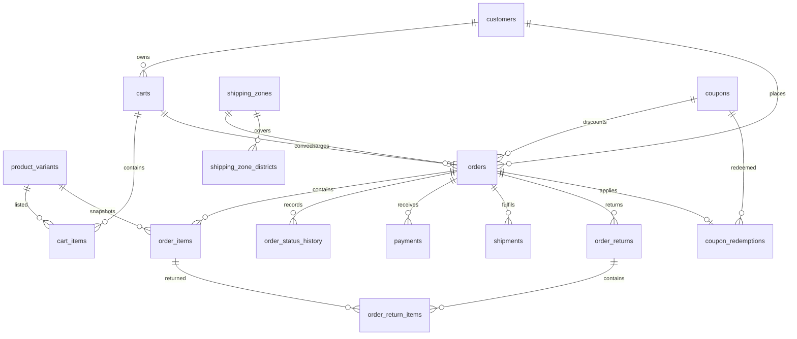

## Context

See `proposal.md` for motivation and the five capability specs for the behavior this design must
deliver. Scope follows `docs/plan.md` items 5, 14, 15, 16, 17, 18, and 26.

The migration stream now contains `20260101000000_init`, `20260102000000_catalog`,
`20260103000000_inventory`, and `20260104000000_customers_auth`. `src/expected-version.ts` points at the
customers/auth migration, and `db:migrate` refuses to apply anything after a checksum change. This
change adds the order-side tables through that same stream.

Constraints that shape the design:

- One PostgreSQL database per client, one shared schema, no `client_id` columns.
- PostgreSQL 16; Prisma 6.19.3; migrations are committed SQL and forward-only.
- Money is BDT only and stored as integer poisha, matching catalog and inventory.
- Prices are tax-inclusive in v1; the order stores the included tax amount for reporting only.
- Guest checkout is allowed, so an order cannot require a customer row.
- Order statuses are `pending`, `confirmed`, `processing`, `shipped`, `delivered`, `cancelled`,
  `returned`, and `partially_delivered`; COD orders start as `pending`.
- Payment methods are `cod`, `bkash`, and `shurjopay`; the courier is Steadfast.
- Delivery charge is a flat fee by zone; coupons are percentage or fixed, non-stacking, and limited by
  date, total usage, and per-customer usage.
- Carts, orders, payments, shipping, and returns have no API yet. This change adds schema, constraints,
  and integration tests only.
- The single `schema.prisma` file is now 436 lines and would roughly double. Prisma multi-file schemas
  have been GA since 6.7.0, so this change splits the schema by domain.

## Goals / Non-Goals

**Goals:**

- A normalized order-side schema that checkout, order management, payment adapters, courier adapters,
  and coupon administration can use without restructuring.
- Immutable order snapshots for product data, delivery data, and money totals.
- An append-only order status history and return records that preserve business history.
- Database-enforced integrity for cart ownership, line uniqueness, totals arithmetic, payment states,
  zone mapping, coupon values, and return quantities.
- A maintainable Prisma schema split into domain files without changing the migration stream.
- Integration tests that prove the constraints against real PostgreSQL.

**Non-Goals:**

- Checkout transactions, stock reservation/release/deduction, idempotency, row locking, or payment
  gateway/courier HTTP calls. Those belong to the API changes.
- Tax-rate calculation or invoice rendering. The order stores the included tax amount supplied by the
  later checkout flow.
- Refund execution, gateway refund reconciliation, or accounts-receivable accounting.
- Seed zones, coupons, orders, or demo data; the seed change owns defaults.
- Partial-shipment business rules, split fulfilment UI, or courier status mapping beyond a stored
  status.
- Notifications, admin screens, storefront code, or customer-facing coupon eligibility rules.
- Multi-currency, multi-warehouse shipping, cross-border delivery, or per-client schema branches.

## Decisions

### 1. Carts are ephemeral rows, not price snapshots

`carts` stores `id`, nullable `customer_id`, `status` (`active`, `converted`, `abandoned`), optional
`expires_at`, and timestamps. `cart_items` stores `cart_id`, `variant_id`, a positive `quantity`, and
timestamps, with `PRIMARY KEY (id)` and `UNIQUE (cart_id, variant_id)`.

- **Why:** one row per variant makes quantity updates and duplicate prevention structural. No price is
  stored because checkout must re-read the current variant price and stock; a stale cart price would
  invite the exact bug the project rules forbid.
- **Alternatives:** a JSONB cart payload (no uniqueness or quantity constraint), one cart row per
  customer (cannot support guest carts or multiple devices), or storing price snapshots in the cart
  (adds a second source of truth before checkout).
- `carts.customer_id` uses `ON DELETE CASCADE` because a cart is transient customer data. Guest carts
  simply have no customer. `cart_items.variant_id` uses `ON DELETE CASCADE` so removing an unsold
  variant also removes it from carts.
- Cart status and `expires_at` let a later cleanup job abandon stale carts without deleting their
  history immediately. The schema does not automatically expire carts.

### 2. Orders are permanent snapshots with one optional cart link

`orders` stores `id`, a unique `order_number`, nullable `customer_id` (`ON DELETE SET NULL`), nullable
unique `cart_id` (`ON DELETE SET NULL`), contact fields, delivery-address snapshot fields, the
`shipping_zone_id`, the delivery fee snapshot, an optional `coupon_id`, status, money totals, and
timestamps.

- **Why:** an order must survive customer deletion, catalog changes, and cart cleanup. The nullable
  `cart_id` with a unique index enforces "one cart produces at most one order" while keeping the order
  independent of cart lifetime. Contact and address fields are copied onto the order instead of joined
  from `customers` or `customer_addresses`.
- **Alternatives:** a separate `order_addresses` table (supports billing and shipping but adds a join
  for a single delivery snapshot), JSONB address data (no shape checks), or requiring a customer row
  (breaks guest checkout).
- `order_number` is a non-empty unique string generated by the API. No database sequence is introduced
  because the later order API may use a date-prefixed format.
- `shipping_zone_id` is required and uses `ON DELETE RESTRICT`; the order also stores
  `delivery_fee_poisha` so a later zone fee change cannot rewrite history.
- `coupon_id` is nullable and uses `ON DELETE RESTRICT`. A check requires `coupon_id IS NOT NULL OR
  discount_poisha = 0`, so an untracked discount cannot appear on an order.
- Orders are effectively permanent: `order_items`, `order_status_history`, `payments`, `shipments`,
  `order_returns`, and `coupon_redemptions` all use `ON DELETE RESTRICT`. An initial history row exists
  for every order, so deleting an order is always blocked once it is created.

### 3. Order money is integer poisha with arithmetic checks

`orders` stores `subtotal_poisha`, `discount_poisha`, `delivery_fee_poisha`, `tax_poisha`, and
`total_poisha`, all `INTEGER NOT NULL`.

Checks enforce:

```sql
subtotal_poisha >= 0
discount_poisha >= 0 AND discount_poisha <= subtotal_poisha
delivery_fee_poisha >= 0
tax_poisha >= 0 AND tax_poisha <= subtotal_poisha
total_poisha >= 0
total_poisha = subtotal_poisha - discount_poisha + delivery_fee_poisha
```

- **Why:** totals must be reproducible after catalog prices, zone fees, or tax settings change. The
  check catches arithmetic mistakes at the database boundary. Tax is stored as the included portion of
  the subtotal, not an extra charge, matching the v1 tax-inclusive decision.
- **Alternatives:** compute totals from current variant prices on read (history changes), store a
  single total (cannot explain the amount), or add tax to the total (conflicts with tax-inclusive
  pricing).
- The API computes the values inside the checkout transaction; the schema only guarantees internal
  consistency, not that the subtotal matches today's catalog.

### 4. Order items snapshot product data and protect catalog history

`order_items` stores `id`, `order_id`, `variant_id`, `product_name`, `variant_sku`, `attributes` JSONB,
`unit_price_poisha`, `quantity`, `line_total_poisha`, and `created_at`.

- **Why:** product names, attributes, and prices change. An order line must show what the customer
  actually bought. Storing the snapshots avoids joining to mutable catalog rows for display while the
  variant foreign key keeps the line traceable and prevents deleting a variant with order history.
- **Alternatives:** a pure variant foreign key (display changes when the catalog changes), a pure JSONB
  snapshot (loses referential integrity and inventory traceability), or storing `product_id` as well as
  `variant_id` (duplicates the variant-to-product relation and can disagree).
- Checks enforce `quantity > 0`, `unit_price_poisha >= 0`, `line_total_poisha >= 0`, and
  `line_total_poisha = unit_price_poisha * quantity`. `UNIQUE (order_id, variant_id)` prevents duplicate
  lines for one variant.
- `variant_id` uses `ON DELETE RESTRICT`. Catalog flows archive variants instead of deleting sellable
  rows.

### 5. Order status history is append-only

`order_status_history` stores `id`, `order_id`, nullable `from_status`, `to_status`, nullable
`changed_by_admin_id` (`ON DELETE SET NULL`), optional `note`, and `created_at`.

- **Why:** the plan requires an order lifecycle and an audit trail of status changes. A separate table
  keeps every transition, including the initial `pending` row, without mutating the order row's history.
- **Alternatives:** a single `status` column only (no history), a JSONB array on the order (harder to
  query and constrain), or a generic audit table (change #6 owns the broader audit log; this table is
  order-specific).
- A `BEFORE UPDATE OR DELETE` trigger rejects changes to existing history rows. The initial row and
  subsequent rows are written by the API in the same transaction as the order/status change.
- `from_status` is nullable only for the initial row. `to_status` uses the same order status enum as
  `orders.status`. The database does not enforce which transitions are legal; the orders API will.
- `changed_by_admin_id` is nullable for system-created rows. A later API can require an admin for manual
  transitions.

### 6. Returns have a header and item rows with quantity validation

`order_returns` stores `id`, `order_id`, a status (`requested`, `approved`, `rejected`, `received`,
`refunded`, `cancelled`), a reason, `refund_total_poisha`, lifecycle timestamps, and timestamps.
`order_return_items` stores `id`, `return_id` (`ON DELETE CASCADE`), `order_item_id`
(`ON DELETE RESTRICT`), a positive `quantity`, a non-negative `refund_amount_poisha`, and optional
reason text, with `UNIQUE (return_id, order_item_id)`.

- **Why:** returns need their own lifecycle and can cover several order lines. The item table keeps the
  returned quantity and refund amount per line rather than burying them in JSON.
- **Alternatives:** return data on the order row (only one return, no item detail), JSONB items (no
  quantity checks), or refunding through the payments table only (loses the return reason and item
  detail).
- A `BEFORE INSERT OR UPDATE` trigger checks that the referenced order item belongs to the return's
  order and that the cumulative returned quantity for that order item does not exceed the ordered
  quantity. The trigger sums existing return-item rows, so concurrent writers still need a transaction
  that serializes returns for the same order item.
- Deleting a return removes its items. Deleting an order with returns is blocked by the header's
  `ON DELETE RESTRICT`.

### 7. Payments are attempts with explicit state and no secrets

`payments` stores `id`, `order_id` (`ON DELETE RESTRICT`), method (`cod`, `bkash`, `shurjopay`), status
(`pending`, `authorized`, `paid`, `failed`, `cancelled`, `refunded`, `partially_refunded`),
`amount_poisha`, optional unique-per-method `provider_reference`, optional `failure_reason`, lifecycle
timestamps, and timestamps.

- **Why:** online gateways fail and retry, and COD is collected later. Multiple attempt rows preserve
  that history without overwriting the previous failure. Provider references allow reconciliation
  without storing raw webhook payloads or credentials.
- **Alternatives:** one payment row per order (loses retry history), storing gateway payloads in JSONB
  (risks leaking secrets and personal data), or a separate table per provider (duplicates lifecycle
  logic and breaks the adapter boundary).
- `amount_poisha > 0`. A partial unique index on `(method, provider_reference)` where the reference is
  not null prevents duplicate reconciliation. COD rows normally have no provider reference.
- Checks require `paid_at` for `paid`, `refunded_at` for `refunded`/`partially_refunded`, and
  `cancelled_at` for `cancelled`. The API owns the sum-of-payments check against the order total.
- No provider credentials, raw payloads, card numbers, or CVV columns exist.

### 8. Delivery zones map districts to flat fees; shipments track courier state

`shipping_zones` stores `id`, a unique `code`, `name`, `delivery_fee_poisha`, `is_active`, and
timestamps. `shipping_zone_districts` stores `district` as the primary key and `zone_id`
(`ON DELETE CASCADE`). `shipments` stores `id`, `order_id` (`ON DELETE RESTRICT`), courier
(`steadfast`), status, optional unique `tracking_number`, `cod_amount_poisha`, lifecycle timestamps, and
timestamps.

- **Why:** the delivery fee is flat per zone, so a zone table plus a district lookup is enough. District
  as the mapping key enforces "one district, one zone" without a composite uniqueness rule. Orders keep
  the zone id and fee snapshot so historical invoices survive fee changes.
- **Alternatives:** a district array on the zone (hard to enforce one-zone-per-district and awkward to
  query), a hard-coded two-zone enum (cannot add zones without a migration), or calculating the fee
  from the address without storing it on the order (history changes when fees change).
- The zone and district mappings are seeded by the later seed change; this migration creates the tables
  only.
- Shipment statuses are `pending`, `booked`, `picked_up`, `in_transit`, `delivered`, `returned`,
  `cancelled`, and `failed`. A partial unique index on `tracking_number` where it is not null prevents
  duplicate courier identifiers. `delivered` requires `delivered_at`.
- Multiple shipments per order are allowed because the order status set includes `partially_delivered`.
  The API owns the rule that shipment statuses and order statuses stay coherent.

### 9. Coupons are definitions plus redemption history

`coupons` stores `id`, a unique uppercase `code`, `discount_type` (`percentage`, `fixed`),
`discount_value`, `min_order_poisha`, `starts_at`, `expires_at`, nullable `total_usage_limit`, nullable
`per_customer_limit`, `is_active`, and timestamps.

`coupon_redemptions` stores `id`, `coupon_id` (`ON DELETE RESTRICT`), unique `order_id`
(`ON DELETE RESTRICT`), nullable `customer_id` (`ON DELETE SET NULL`), `discount_poisha`, and
`created_at`.

- **Why:** definitions and redemptions have different lifecycles. Usage counts are derived from
  redemption rows, so they cannot drift. A unique redemption per order enforces the no-stacking rule at
  the database boundary.
- **Alternatives:** storing used counts on the coupon (drifts and needs every redemption path to update
  it), coupon data on the order only (cannot list or validate coupons), or stacking multiple coupons
  (contradicts the v1 decision).
- Checks enforce the uppercase code format, `discount_type` value shape, non-negative minimum order,
  `starts_at < expires_at`, and positive usage limits when present.
- A coupon with redemptions cannot be deleted; deactivate it instead. A redemption stores the discount
  amount that was applied, so later coupon edits do not rewrite order history.
- Total and per-customer limits are derived by counting redemptions. The API must enforce them inside
  the checkout transaction; the schema cannot make a count-and-insert check atomic without a lock.
- `orders.coupon_id` and `coupon_redemptions.order_id` are written together by checkout. The unique
  redemption protects against double application; the redundant order reference keeps order reads
  cheap. This is a deliberate trade-off documented under risks.

### 10. Foreign-key and deletion rules

| Parent deletion | Effect |
| --- | --- |
| Customer | Carts cascade; orders keep history and set `customer_id` null; redemption customer nulls |
| Cart | Cart items cascade; order `cart_id` nulls |
| Variant | Cart items cascade; order items block the delete |
| Order | Items, history, payments, shipments, returns, redemptions block the delete |
| Shipping zone | District mappings cascade; orders block the delete |
| Coupon | Redemptions block the delete |
| Return | Return items cascade |
| Admin user | Order history keeps the row and nulls the actor |

- **Why:** ephemeral rows (carts, mappings, return items) can disappear with their parent; history rows
  (orders, order items, payments, shipments, returns, redemptions) must not. Orders therefore cannot be
  deleted in normal operation; cancellation and return statuses express the business outcome.

### 11. Split the Prisma schema by domain

Move the existing models into `prisma/models/` (`catalog.prisma`, `inventory.prisma`, `auth.prisma`,
`orders.prisma`, `payments.prisma`, `shipping.prisma`, `promotions.prisma`) and keep `generator` and
`datasource` in `prisma/schema.prisma`. Point `package.json`'s Prisma `schema` setting at `./prisma` so
every Prisma command loads the folder. Keep `prisma/migrations/` beside `schema.prisma`.

- **Why:** the order-side models add roughly 400 lines to an already large file. Multi-file schemas are
  GA in Prisma 6.19, and domain files match the capability boundaries. Models and enums relate across
  files without imports.
- **Alternatives:** keep one file (simpler now, harder to review later) or split later (moves many lines
  twice). The move is mechanical and must not change generated SQL.
- The migration remains a single SQL file; schema file layout does not affect migration history.

### 12. One forward migration, no backfill

Add `prisma/migrations/20260105000000_orders_payments_shipping/migration.sql` after the customers/auth
migration, containing enums, tables, checks, indexes, foreign keys, the status-history trigger, and the
return-item validation trigger in dependency order.

- **Why one migration:** all order-side tables are new and always applied together; there is no existing
  order data to backfill.
- Regenerate `src/expected-version.ts` through `db:generate`; CI fails when it is stale.
- The timestamp follows the stream (`20260105...`), not the wall clock, so ordering stays obvious.

### 13. Relationship overview



## Risks / Trade-offs

- **Stored order snapshots can drift from the catalog** → this is intentional; snapshots preserve what
  the customer bought. The API writes them once at checkout and never rewrites them.
- **Totals and return quantities are only as correct as the API transaction** → arithmetic and
  per-line quantity checks catch invalid rows, but the API must compute subtotals, discounts, tax, and
  cumulative returns consistently.
- **Coupon usage limits can be exceeded by concurrent checkouts** → a count-then-insert is not atomic.
  The checkout API must lock the coupon or the order/customer scope, or use a serializable transaction.
- **Return quantity trigger can race** → two concurrent returns for the same order item can both pass
  the cumulative check. The returns API must serialize writes per order item (row lock or serializable
  transaction).
- **`orders.coupon_id` duplicates `coupon_redemptions.order_id`** → checkout writes both in one
  transaction. The unique redemption is the enforcement point; a reconciliation query can detect drift.
- **Order status transitions are not enforced by the database** → the orders API owns the transition
  graph, including the owner/manager permission rule. The schema only rejects unsupported values.
- **Partial shipments and partially delivered orders need coherent rules** → the data model allows
  multiple shipments; the shipping API must keep order and shipment statuses consistent.
- **Tax is stored but not calculated here** → the checkout API must use the later settings change's tax
  rate. The order only guarantees the tax portion is not added twice.
- **Splitting the Prisma schema can silently drop models if the folder is misconfigured** → set the
  Prisma schema path to the directory, run `prisma validate` and `prisma generate`, and assert the
  generated client still exposes existing models.
- **Coupon and zone seeds do not exist yet** → zones, district mappings, and coupons remain empty until
  the seed change. Checkout cannot calculate a delivery fee before that data exists.

## Open Questions

- Exact order-number format (date prefix, sequence width) can be decided by the orders API without a
  schema change.
- Courier status strings from Steadfast can be mapped to the stored shipment statuses by the adapter;
  no new column is needed if the mapping is lossless.
- Whether tax should be stored per line for invoices can be revisited in the tax/settings change; the
  order-level included-tax amount is sufficient for v1.
